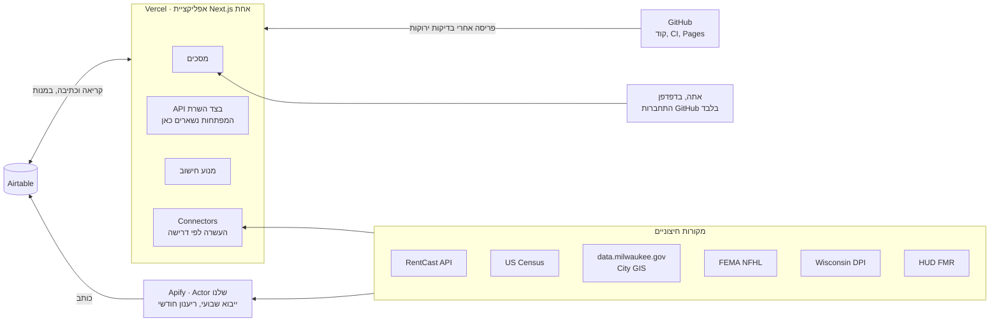

# Milwaukee Real Estate Analyzer – אפיון מערכת

גרסה: 16.11.2026 · מקור: מסמך האפיון ב-Claude Docs (טאב "אפיון"), עם עדכונים עד היום. דוחות שלב 0 ושלב 1 מסוכמים בנספחים.

מערכת Web אישית למשתמש יחיד לאיתור, איסוף וניתוח עסקאות נדל"ן למגורים בעיר Milwaukee, ויסקונסין. המערכת נבנית בלי Scraping: הנכסים מגיעים מ-RentCast API ומהוספה ידנית, וההעשרה מגיעה מ-API ציבוריים חינמיים. לצורכי לימוד, Apify מריץ את המשימות המתוזמנות כ-Actor שלנו. העלות השוטפת: $0 בפיתוח ו-$24 לחודש בשימוש שוטף.

**מצב ב-16.11.2026:** ההחלטות D-01 עד D-19 ו-P1-1 עד P1-5 אושרו. שלב 0 (אימות) הושלם ברובו, ונשארו בו מפתח RentCast, בדיקת הכיסוי וטבלת ההנחות. הקוד של שלב 1 (תשתית) כתוב ונבדק בענף `phase-1`, וממתין למפתחות GitHub ו-Airtable. mockup של הדשבורד עם נתוני דמה פורסם ב-[buildwise123.github.io/nadlan](https://buildwise123.github.io/nadlan/).

**איך לקרוא את המסמך:** דרישות מסומנות **מאושר** (נוסחו על ידך), **הנחה לאימות** (מזהה A-xx) או **טרם הוכרע** (מזהה Q-xx). כל נושא פתוח מרוכז בפרק ההחלטות (D-xx). מחירי RentCast ו-Vercel נבדקו בעמודים הרשמיים ב-11.11.2026. נתוני העירייה נבדקו ישירות מול ה-API שלה. מחירי Airtable נלקחו ממדריכים חיצוניים ודורשים אימות.

**דוחות השלבים:** סיכום שלב 0 בנספח א, מצב שלב 1 בנספח ב, ה-mockup ועמוד הדמה בנספח ג.

## 1. דרישות עסקיות ופונקציונליות

המערכת היא כלי אישי למשתמש יחיד. היא מאתרת נכסי מגורים למכירה ב-Milwaukee, מעשירה אותם בנתונים ציבוריים מתועדים ומחשבת את כדאיות ההשקעה. בכל שורה מופיע סטטוס: **מאושר** = נוסח על ידך במפורש; **הנחה לאימות** = הנחה שלי שדורשת אישור; **טרם הוכרע** = דורש החלטה. אפשר לשנות את הסטטוס ישירות בטבלה.

### 1.1 מטרות עסקיות

- לקצר את הדרך מגילוי נכס ועד החלטת go / no-go ראשונית.
- לקבל החלטות על סמך נתונים עם מקור ותאריך, לא על סמך הערכות.
- להשוות בין 2–5 חלופות רכישה על בסיס אחיד של הנחות.

### 1.2 דרישות פונקציונליות

| מזהה | תחום | דרישה | סטטוס |
| --- | --- | --- | --- |
| FR-01 | איתור | הוספה ידנית של נכס: כתובת, קישור למקור, מחיר מבוקש, סטטוס | מאושר |
| FR-02 | איתור | ייבוא אוטומטי של נכסים למכירה ממקור מורשה בלבד (המקור עצמו: Q-01) | מאושר |
| FR-03 | איתור | שמירת כתובת מנורמלת, קואורדינטות וקישור למקור לכל נכס | מאושר |
| FR-04 | איתור | מניעת כפילויות לפי Tax Key עירוני (מזהה חלקה) וכתובת מנורמלת | מאושר |
| FR-05 | איתור | מעקב אחר שינויי מחיר וסטטוס (Active, Pending, Sold, Withdrawn) עם תאריך לכל שינוי | מאושר |
| FR-06 | העשרה | זיהוי Census Tract ושכונה לפי קואורדינטות | מאושר |
| FR-07 | העשרה | נתוני אוכלוסייה והכנסה מ-US Census (ACS) ברמת Tract | מאושר |
| FR-08 | העשרה | נתוני פשיעה מ-Milwaukee Police Department ברדיוס סביב הנכס ובשכונה | מאושר |
| FR-09 | העשרה | בתי ספר קרובים ודירוג Report Card מ-Wisconsin DPI | מאושר |
| FR-10 | העשרה | עסקאות השוואה (comps) מנתוני המכירות של עיריית Milwaukee | מאושר |
| FR-11 | העשרה | שומה עירונית ומס נכס שנתי | מאושר |
| FR-12 | העשרה | סיכון הצפה לפי מפות FEMA | מאושר |
| FR-13 | העשרה | מידע עירוני נוסף: הפרות בנייה, היתרים, צנרת עופרת (אושר, D-13) | מאושר |
| FR-14 | אמינות | לכל נתון: מקור, תאריך איסוף, תקופת מדידה, רמת דיוק ורמת אמינות | מאושר |
| FR-15 | אמינות | הפרדה מלאה בין נתון ידני לנתון חיצוני; נתון ידני לא נדרס בריענון | מאושר |
| FR-16 | ניתוח | חישוב NOI, Cap Rate, Cash Flow ו-Cash-on-Cash לכל נכס | מאושר |
| FR-17 | ניתוח | שלושה תרחישים: שמרני, בסיס ואופטימי | מאושר |
| FR-18 | השוואה | בחירת 2–5 נכסים והשוואה לפי מחיר, שכונה, סיכון, תשואה ותזרים | מאושר |
| FR-19 | Dashboard | תמונת מצב: נכסים חדשים, שינויי מחיר, נכסים מובילים לפי תשואה | מאושר |
| FR-20 | ניתוח | ציון סיכון מסכם לנכס, לפי נוסחה שקופה (נוסחה לאישור בשלב 3, D-08) | מאושר |
| FR-21 | ניתוח | מימון במשכנתא כחלק מהחישוב, כי Cash-on-Cash תלוי בו | הנחה לאימות |
| FR-22 | תפעול | ריענון מתוזמן ב-Apify: נכסים פעם בשבוע, נתוני העשרה פעם בחודש (D-03, D-16) | מאושר |
| FR-23 | תפעול | התראה במייל על נכס חדש או ירידת מחיר, אחרי הגרסה הראשונה (D-12) | מאושר |
| FR-24 | תפעול | ייצוא ניתוח נכס ל-PDF או CSV | טרם הוכרע |

### 1.3 דרישות לא-פונקציונליות

| מזהה | נושא | דרישה | סטטוס |
| --- | --- | --- | --- |
| NFR-01 | חוקיות | אין Scraping ממקורות שתנאי השימוש שלהם אוסרים זאת | מאושר |
| NFR-02 | אמת | אין השלמת נתונים חסרים בהערכת AI; שדה חסר נשאר ריק ומסומן "חסר" | מאושר |
| NFR-03 | אבטחה | מפתחות וסיסמאות רק ב-Environment Variables של Vercel, לעולם לא ב-Git | מאושר |
| NFR-04 | אבטחה | גישה למערכת רק אחרי התחברות של המשתמש היחיד | מאושר |
| NFR-05 | לוגים | לוג לכל ריצת ייבוא, העשרה וחישוב, כולל שגיאות ומספר רשומות | מאושר |
| NFR-06 | איכות | בדיקות אוטומטיות לכל רכיב, דוח תוצאות בכל שלב | מאושר |
| NFR-07 | תיעוד | README מעודכן: התקנה, הגדרות, מקורות נתונים, נוסחאות | מאושר |
| NFR-08 | גיבוי | ייצוא שבועי של בסיס ה-Airtable ל-CSV בנוסף לגיבוי המובנה | הנחה לאימות |
| NFR-09 | ביצועים | טעינת מסך עד 3 שניות ב-100 נכסים פעילים | הנחה לאימות |
| NFR-10 | שפה | ממשק בעברית (RTL), מונחים פיננסיים ושמות טכנולוגיים באנגלית | מאושר |

### 1.4 מחוץ לתחום בגרסה הראשונה

ריבוי משתמשים, אפליקציית מובייל, ערים מחוץ ל-Milwaukee, ניהול נכס אחרי רכישה, הגשת הצעות, ייעוץ השקעות.

### 1.5 הנחות שדורשות אימות

| מזהה | הנחה | השפעה אם שגויה |
| --- | --- | --- |
| A-01 | "מגורים" = בית צמוד קרקע, duplex ובניין עד 4 יחידות; בלי condo | מודל הנתונים וחישובי שכר דירה ליחידה |
| A-02 | תחום גאוגרפי = גבולות העיר Milwaukee, לא המחוז | נתוני העירייה מכסים רק את העיר |
| A-03 | אסטרטגיה = קנייה והשכרה (buy & hold), לא flip | מבנה החישובים |
| A-04 | מימון במשכנתא רגילה; ריבית, הון עצמי ותקופה מוזנים ידנית | Cash-on-Cash |
| A-05 | נפח: עד כמה מאות נכסים בשנה | מגבלות Airtable ועלויות |
| A-06 | שכר דירה צפוי מוזן ידנית, עם נתון ייחוס חיצוני לצידו | אמינות התשואה |
| A-07 | מטבע USD, שטח ב-sqft | תצוגה |

**מצב ההנחות ב-15.11.2026:** A-01, A-02 ו-A-03 אושרו (D-01), ו-A-06 אושרה (D-07). A-04, A-05 ו-A-07 ייבדקו בשלב 0.

### 1.6 נושאים שהוכרעו

| מזהה | נושא | הכרעה (15.11.2026) |
| --- | --- | --- |
| Q-01 | מקור אוטומטי לנכסים למכירה | RentCast API והוספה ידנית (D-02) |
| Q-02 | Apify | לצורכי לימוד: Actor שלנו מריץ את המשימות המתוזמנות, רק מול מקורות מורשים (D-16) |
| Q-03 | מקור ייחוס לשכר דירה | אתה קובע; HUD FMR והערכת RentCast מוצגים כייחוס (D-07) |
| Q-04 | הגדרת ציון הסיכון | ציון מסכם ושקוף, בלי מאפיינים מוגנים; הנוסחה לאישור בשלב 3 (D-08) |
| Q-05 | שיטת ההתחברות | GitHub, חשבון אחד בלבד (D-06) |
| Q-06 | התראות במייל | אחרי הגרסה הראשונה (D-12) |
| Q-07 | תוכנית Airtable | חינם בפיתוח, Team בשימוש שוטף (D-04) |
| Q-08 | נתונים עירוניים נוספים | הפרות קוד בנייה, היתרי בנייה, צנרת מים מעופרת (D-13) |

## 2. ארכיטקטורה

המלצה: אפליקציית Next.js אחת ב-TypeScript על Vercel, עם Airtable כמסד נתונים. כל הקריאות למקורות חיצוניים ול-Airtable רצות בצד השרת, כך שהמפתחות לא מגיעים לדפדפן. המשימות המתוזמנות רצות כ-Actor שלנו ב-Apify, לצורכי לימוד (D-16).

### 2.1 בחירת טכנולוגיות

| רכיב | המלצה | חלופה שנשקלה | נימוק |
| --- | --- | --- | --- |
| Frontend + Backend | Next.js (App Router) + TypeScript | React SPA (Vite) + שרת נפרד | קוד אחד, פריסה אחת, מפתחות נשארים בשרת |
| UI | Tailwind CSS + shadcn/ui, גרפים ב-Recharts | MUI | תמיכה טובה ב-RTL, קל לתחזקה |
| Database | Airtable (תוכנית Team) | Supabase (Postgres) | אתה יכול לראות ולתקן נתונים ישירות בממשק Airtable. Supabase נשאר כתוכנית מגירה אם נחרוג מהמגבלות |
| Hosting | Vercel | Netlify | הפלטפורמה הטבעית ל-Next.js, כולל Cron |
| משימות מתוזמנות | Apify: Actor שלנו ב-TypeScript עם Schedules | Vercel Cron | לימוד הפלטפורמה על נתונים אמיתיים (D-16), בתוך המכסה החינמית של $5 לחודש |
| מקור נכסים | RentCast API + הוספה ידנית | Apify Actors על Zillow (Scraping), MLS feed | רישיון מסחרי במקום Scraping אסור |
| התחברות | next-auth v4 עם התחברות GitHub, מוגבלת לחשבון שלך | Vercel Authentication, Auth.js v5 (עדיין בבטא) | מגן גם על נתיבי ה-API ולא רק על הדפים (Q-05, P1-2) |
| בדיקות | Vitest (יחידה), MSW (דמיית API), Playwright (מסכים) | Jest, Cypress | מהיר ומותאם ל-Next.js |
| CI | GitHub Actions: בדיקות בכל push | — | אף שינוי לא עולה בלי בדיקות ירוקות |
| לוגים | pino (JSON) + טבלת Sync Runs ב-Airtable | Axiom / Better Stack | ב-Hobby של Vercel הלוגים נשמרים שעה בלבד, לכן סיכום כל ריצה נשמר ב-Airtable |



הדפדפן מדבר רק עם האפליקציה. רק השרת וה-Actor ב-Apify מדברים עם Airtable ועם המקורות החיצוניים, ושניהם משתמשים באותו קוד Connectors.

### 2.2 עקרונות מנחים

- **שכבת Connectors:** מודול קטן לכל מקור (RentCast, Census, MPD, DPI, Sales, MPROP, FEMA). לכל מודול בדיקות משלו, ואפשר להחליף אותו בלי לגעת בשאר המערכת. אותו קוד משמש גם את האפליקציה וגם את ה-Actor ב-Apify.
- **מנוע חישוב טהור:** נוסחאות ההשקעה הן פונקציות TypeScript ללא גישה לרשת, עם כיסוי בדיקות מלא. התוצאה נשמרת ב-Airtable יחד עם גרסת הנוסחה.
- **נתוני ייחוס גדולים לא מועתקים:** כי 100 אלף אירועי פשיעה בשנה ואלפי עסקאות לא נכנסים ל-Airtable. המערכת שואלת את ה-API של העירייה ושומרת רק סיכום לכל נכס, עם פרטי המקור.
- **Provenance בכל שמירה:** אין שמירה של ערך חיצוני בלי מקור, תאריך איסוף, תקופת מדידה, דיוק ואמינות. אכיפה ברמת הקוד.
- **ידני גובר ונשמר:** ערך שהזנת ידנית נשמר בשדה נפרד ולא נדרס בריענון. המסך מציג את שני הערכים כשהם שונים.
- **עמידות לתקלות:** כשל של מקור אחד לא עוצר את העשרת הנכס. השדה מסומן "נכשל", השגיאה נרשמת בלוג, ויש ניסיון חוזר בריצה הבאה.
- **עבודה במנות מול מגבלות:** Airtable מגביל 5 בקשות לשנייה לבסיס, ופונקציה ב-Vercel Hobby מוגבלת ל-300 שניות. לכן העבודה מתבצעת במנות קטנות עם השהיה ביניהן.
- **סודות:** קובץ `.env.local` מחוץ ל-Git, `.env.example` ללא ערכים בתוך Git, והערכים בפועל רק ב-Vercel וב-Apify Secrets. נתיבי API שה-Actor קורא להם מוגנים ב-`ACTOR_SECRET`.

### 2.3 תהליכים מרכזיים

1. **ייבוא שבועי:** ה-Actor ב-Apify מפעיל את הייבוא מ-RentCast פעם בשבוע, לפי Schedule. המערכת מנרמלת כתובת, מאתרת את ה-Tax Key לפי הקואורדינטות בשירות החלקות של העירייה ומזהה כפילויות. אז היא יוצרת נכס חדש או רושמת שינוי מחיר או סטטוס.
2. **הוספה ידנית:** אתה מזין כתובת, קישור ומחיר. משם הנכס עובר באותה בדיקת כפילויות. המערכת לא קוראת את תוכן הקישור, כי זה היה Scraping.
3. **העשרה:** לכל נכס חדש רצים Geocode ו-Tract, אחריהם שכונה, ואז במקביל ACS, פשיעה, בתי ספר, עסקאות השוואה, מס, הצפה, הפרות בנייה, היתרים וצנרת עופרת. ריענון חודשי לנכסים פעילים, גם הוא דרך ה-Actor.
4. **ניתוח:** אתה מזין או מאשר הנחות (שכר דירה, שיפוץ, מימון), והמערכת מחשבת שלושה תרחישים ושומרת את התוצאה עם חותמת זמן.

## 3. מודל נתונים ב-Airtable

בסיס אחד עם 12 טבלאות. העיקרון המרכזי הוא טבלת **Data Points**: כל נתון על נכס, חיצוני או ידני, נשמר בה כשורה עם מקור, תאריכים, דיוק ואמינות. טבלת Properties מחזיקה עותק של הערך העדכני לתצוגה מהירה. שמות השדות באנגלית, כי הקוד פונה אליהם.

### 3.1 הטבלאות והקשרים ביניהן

| טבלה | תפקיד | מקושרת ל- | הערכת נפח בשנה |
| --- | --- | --- | --- |
| Properties | נכס פיזי אחד (חלקה) | כל הטבלאות | מאות |
| Listings | הצעת מכירה של נכס במקור מסוים | Properties, Sources | מאות |
| Listing Events | שינוי מחיר או סטטוס, עם תאריך | Listings | אלפים |
| Data Points | נתון בודד עם Provenance מלא | Properties, Sources, Sync Runs | עשרות אלפים (ראו 3.4) |
| Sources | קטלוג מקורות והרשאות | — | עשרות |
| Comparable Sales | עסקת השוואה לנכס נבחן | Properties, Sources | אלפים |
| Schools | בית ספר ודירוג DPI לשנה | Sources | מאות |
| Property Schools | בית ספר קרוב לנכס + מרחק | Properties, Schools | אלפים |
| Scenarios | הנחות ותוצאות ניתוח לתרחיש | Properties | מאות |
| Defaults | הנחות ברירת מחדל לכל תרחיש (כולל שיעור מס) | Sources | עשרות |
| Compare Sets | קבוצת השוואה שמורה של 2–5 נכסים | Properties | עשרות |
| Sync Runs | לוג של כל ריצה ושגיאותיה | Data Points | מאות |

### 3.2 Properties

| שדה | סוג Airtable | מקור | הערה |
| --- | --- | --- | --- |
| Name | Formula | מחושב | כתובת מלאה לתצוגה |
| Tax Key | Single line text | MPROP | מפתח מניעת כפילויות ראשי (10 ספרות) |
| Address Normalized | Single line text | מחושב | מפתח משני למניעת כפילויות |
| Address Raw | Single line text | ידני / RentCast | כפי שהתקבל |
| ZIP | Single line text | Census Geocoder |  |
| Latitude, Longitude | Number | Census Geocoder |  |
| Census Tract GEOID | Single line text | Census Geocoder | 11 ספרות |
| Neighborhood | Single line text | City GIS | שכונה עירונית רשמית |
| Assessor Nbhd | Single line text | MPROP | שכונת שומה, משמשת לעסקאות השוואה |
| Property Type | Single select | MPROP / ידני | Single Family, Duplex, Triplex, Fourplex |
| Units, Beds, Baths, Sqft, Lot Sqft, Year Built | Number | MPROP / ידני | עותק של הערך הגובר מ-Data Points |
| Assessed Value | Currency | MPROP |  |
| Est. Annual Tax | Currency | מחושב | שומה × שיעור מס מ-Defaults |
| Flood Zone | Single line text | FEMA NFHL | למשל X, AE |
| Current List Price, Listing Status | Lookup | Listings | מה-Listing הפעיל |
| Pipeline Stage | Single select | ידני | New, Reviewing, Analyzing, Offer, Rejected, Archived |
| My Notes | Long text | ידני |  |
| Enrichment Status | Single select | מערכת | Pending, Partial, Complete, Failed |
| Base Cap Rate, Base Cash Flow, Base CoC | Lookup | Scenarios | מתרחיש הבסיס, למיון ול-Dashboard |
| Risk Score | Number | מחושב | לפי ההגדרה שתאושר (Q-04) |
| Created Via | Single select | מערכת | Manual, RentCast |

### 3.3 Data Points (לב ה-Provenance)

| שדה | סוג Airtable | הערה |
| --- | --- | --- |
| Property | Link |  |
| Metric Key | Single line text | מזהה קבוע, למשל `acs.median_hh_income`, `crime.violent_12m_0.5mi` |
| Category | Single select | Property, Demographics, Crime, Schools, Comps, Tax, Flood, Rent, City (City = הפרות קוד בנייה, היתרי בנייה, צנרת עופרת) |
| Value Number / Value Text | Number / Text | ערך אחד משניהם |
| Unit | Single line text | USD, %, count, sqft |
| Origin | Single select | **External** או **Manual**; זו ההפרדה שדרשת |
| Source | Link → Sources | חובה ל-External |
| Source Reference | URL / Text | קישור או שאילתה מדויקת שממנה נלקח הערך |
| Collected At | Date-time | מתי נאסף |
| Last Verified At | Date-time | מתי נבדק שוב ולא השתנה |
| Period Start / Period End | Date | תקופת המדידה, למשל ACS 2020–2024 |
| Geo Level | Single select | Parcel, Radius 0.5mi, Tract, Neighborhood, ZIP, City |
| Accuracy | Single select | Exact, Aggregated, Estimate with MOE, Vendor Model |
| Margin of Error | Number | לנתוני ACS |
| Reliability | Single select | High, Medium, Low, לפי כללים קבועים לכל מקור |
| Is Current | Checkbox | רק שורה נוכחית אחת לכל נכס + Metric + Origin |
| Sync Run | Link → Sync Runs | איזו ריצה יצרה את השורה |
| Status | Single select | OK, Missing, Failed; נתון חסר מסומן ולא מושלם |

**כלל עדיפות:** כשיש ערך Manual נוכחי הוא גובר בחישובים. הערך ה-External מוצג לצידו ומסומן אם הוא שונה.

### 3.4 טבלאות נוספות (שדות עיקריים)

- **Listings:** Property, Source, Source Listing ID, Listing URL, List Price, Status (Active, Pending, Sold, Withdrawn, Off-Market), First Seen, Last Seen, Days on Market, Is Active.
- **Listing Events:** Listing, Event Date, Event Type (New, Price Change, Status Change), Old Value, New Value, Detected By (Sync Run).
- **Sources:** Name, Organization, URL, License, Access Method (API, File, Manual), Update Frequency, Default Reliability, Terms Checked On, Terms Notes, API Key Required.
- **Comparable Sales:** Subject Property, Comp Tax Key, Comp Address, Sale Date, Sale Price, Sqft, Beds, Baths, Style, Year Built, Distance (mi), Price per Sqft, Included (תיבת סימון, כדי שתוכל להוציא עסקה לא רלוונטית), Source.
- **Schools:** DPI School Code, Name, District, School Type (Public, Charter, Choice), Grades, Address, Latitude, Longitude, Report Card Score, Rating Category, School Year, Source.
- **Property Schools:** Property, School, Distance (mi), Rank.
- **Scenarios:** Property, Scenario Type (Conservative, Base, Optimistic), שדות הנחות (פרק 6.1) עם Origin לכל הנחה, שדות תוצאה (פרק 6.2), Formula Version, Calculated At.
- **Defaults:** Key, Scenario Type, Value, Unit, Source, Effective From, Notes. למשל שיעור מס הנכס ב-Milwaukee לשנה מסוימת, עם קישור לפרסום הרשמי.
- **Compare Sets:** Name, Properties (2–5), Created At, Notes.
- **Sync Runs:** Job Type, Trigger (Apify Schedule, Manual), Started At, Finished At, Status (Success, Partial, Failed), Records Read, Created, Updated, Skipped, Error Count, Error Details, Calls Used per Source.

### 3.5 כללי שמירה שמגנים על מכסת הרשומות

בתוכנית Team מותרות 50,000 רשומות לבסיס (לאימות בעמוד המחירים הרשמי). כדי לא להתקרב לתקרה:

- בריענון, אם הערך לא השתנה, מעדכנים רק את Last Verified At ולא יוצרים שורה חדשה.
- אירועי פשיעה ועסקאות גולמיות לא נשמרים. נשמרים רק סיכומים ועסקאות ההשוואה שנבחרו.
- נכסים בסטטוס Archived מפסיקים להתעדכן.
- הערכה: 300 נכסים × כ-40 מדדים מניבים כ-12,000 שורות Data Points בשנה הראשונה, ועוד שורות רק כשערכים משתנים.

## 4. מקורות נתונים

כל נתוני ההעשרה זמינים דרך API או קבצים רשמיים בחינם. המקור היחיד שעולה כסף הוא רשימת הנכסים למכירה. בדקתי בפועל את ה-API של פורטל הנתונים של Milwaukee: הוא פתוח ללא מפתח, ברישיון Creative Commons Attribution, והוחזרו רשומות אמיתיות.

### 4.1 Apify מול חלופות: המלצה סופית

**הכרעה (D-02, D-16): Apify לא אוסף נכסים מאתרים כמו Zillow. הוא משמש, לצורכי לימוד, להרצת Actor שכתבנו.** יש שני שימושים אפשריים ב-Apify בפרויקט, ורק השני מותר:

1. **איסוף נכסים מ-Zillow, Redfin או Realtor.com: נפסל.** תנאי השימוש של Zillow אוסרים שאילתות אוטומטיות, Scraping ועקיפת CAPTCHA ([סיכום](https://conductatlas.com/platform/zillow/zillow-terms-of-use/prohibition-on-automated-data-collection-and-scraping/)). ה-Actors המוכנים מעבירים את האחריות המשפטית למשתמש, וזה סותר את הנחיה 2 שלך.
2. **Actor שכתבנו, מול מקורות מורשים: מאושר.** ה-Actor קורא ל-RentCast API ול-API של העירייה, רץ לפי Schedule ומשתמש באותו קוד Connectors של האפליקציה. כך לומדים Actors, Schedules, Datasets ו-Secrets על נתונים אמיתיים.

| חלופה למקור נכסים | מותר? | עלות | איכות נתונים | הכרעה |
| --- | --- | --- | --- | --- |
| RentCast API | כן, רישיון מסחרי | $0 ל-50 בקשות, $74 ל-1,000 בקשות בחודש ([מחירון](https://www.rentcast.io/api)) | בינונית; שלמות הכיסוי ב-Milwaukee תיבדק בשלב 0 | **מומלץ** |
| הוספה ידנית + קישור | כן | $0 | גבוהה, אבל דורשת זמן | **תמיד זמין** |
| MLS feed (Metro MLS) דרך מתווך | כן, בהסכם מתווך | תלוי במתווך ובספק | הגבוהה ביותר | לשלב מאוחר |
| ATTOM Data | כן, רישיון מסחרי | לפי הצעת מחיר | גבוהה | כנראה יקר לשימוש אישי |
| Apify Actors על Zillow ודומיו | לא | מ-$19 בחודש | לא יציבה, נשברת כשהאתר משתנה | נפסל |
| מעטפות API לא רשמיות (RapidAPI) | לא | משתנה | לא יציבה | נפסל |

### 4.2 קטלוג המקורות

| מקור | נתונים | אופן חיבור | מגבלות והוראות | הרשאה / רישיון | אמינות | מצב בדיקה |
| --- | --- | --- | --- | --- | --- | --- |
| [RentCast API](https://developers.rentcast.io) | נכסים פעילים למכירה; הערכת שכר דירה | REST, API key | לפי מכסת בקשות; חריגה $0.06–$0.20 לבקשה | רישיון לכל שימוש שלא נאסר ב-Terms; תנאי שמירת הנתונים לבדיקה | Medium. הערכת שכר דירה = Vendor Model, לא עובדה | מחירון ותנאים נבדקו; הכיסוי ייבדק עם המפתח |
| [Census Geocoder](https://geocoding.geo.census.gov) | קואורדינטות ו-Census Tract לכתובת | REST, ללא מפתח | כתובות מסוימות לא מתאימות | ציבורי, חינם | High | נבדק בשלב 0: עובד בלי מפתח |
| [Census ACS 5-Year API](https://www.census.gov/data/developers.html) | אוכלוסייה, הכנסה, דיור, שכר דירה חציוני ברמת Tract | REST, מפתח חינמי (חובה) | מתעדכן פעם בשנה; ערכים הם אומדנים עם MOE | ציבורי | High, כאומדן | נבדק בשלב 0: נדרש מפתח; המהדורה האחרונה 2020–2024 |
| [MPD NIBRS Crime Data](https://data.milwaukee.gov/dataset/wibr) | אירועי פשיעה ברמת כתובת עם קואורדינטות | CKAN Datastore API, ללא מפתח | עדכון יומי; כ-114 אלף רשומות בקובץ הנוכחי; קובץ היסטורי נפרד | CC BY. העירייה מסייגת שימוש להשוואת בטיחות בין אזורים | Medium. נמצאה רשומה עם תאריך בעתיד (2027) | נבדק ב-API |
| [Property Sales Data](https://data.milwaukee.gov/dataset/property-sales-data) | עסקאות מכר עם מחיר, תאריך, שטח, חדרים, סגנון ושכונת שומה | CKAN Datastore API | קובץ לכל שנה. קובץ 2025 עודכן באוקטובר 2026, וקובץ 2026 עדיין לא קיים ב-API, כלומר פיגור של עד שנה | CC BY | High לעסקאות שנרשמו | נבדק ב-API |
| [MPROP](https://data.milwaukee.gov/dataset/mprop) | רשומת שומה לכל חלקה: Tax Key, שווי שומה, שימוש, יחידות, שנת בנייה | CKAN Datastore API / CSV | עדכון יומי (עודכן לאחרונה ב-10.11.2026) | CC BY | High | נבדק ב-API |
| City GIS: גבולות שכונות | פוליגונים של שכונות רשמיות | GeoJSON / ArcGIS REST, נשמר במטמון | משתנה לעיתים רחוקות | ציבורי | High | נבדק בשלב 0: SHP ושירות ArcGIS, מתעדכן כל לילה |
| שיעור מס נכס עירוני | שיעור המס השנתי | הזנה ידנית שנתית ל-Defaults עם קישור לפרסום | משתנה פעם בשנה | ציבורי | High | ייחוס: 22.93 ל-$1,000 (מסי 2025), לאימות מול טבלת השומה הרשמית |
| [Wisconsin DPI Report Cards](https://dpi.wi.gov/wisedash/public/download-files/info) | ציון ודירוג לכל בית ספר | קובץ CSV שנתי; אין API | ייבוא פעם בשנה. חסרות שנים (2014–15, 2019–20). מיקום בתי הספר נדרש מקובץ נפרד | ציבורי | High | נבדק בשלב 0: השנה העדכנית 2024–25 |
| [FEMA NFHL](https://hazards.fema.gov/femaportal/resources/flood_map_svc.htm) | אזור הצפה (FLD\_ZONE) לנקודה | ArcGIS REST, שאילתת נקודה, ללא מפתח | רק שכבות Effective; לא תחליף לקביעת ביטוח | ציבורי | High | לא נבדק: השירות חוסם חיבורים מחוץ לארה"ב; ייבדק מ-Vercel |
| [HUD Fair Market Rents API](https://www.huduser.gov/portal/dataset/fmr-api.html) | שכר דירה ייחוס לפי ZIP ומספר חדרים | REST, טוקן חינמי | שנתי. מייצג את האחוזון ה-40, לא שכר שוק של דירה מסוימת | ציבורי | Medium כייחוס | נבדק בשלב 0: נדרש טוקן |
| נתונים עירוניים נוספים (Q-08) | הפרות בנייה, היתרים, צנרת עופרת | CKAN API | תלוי במאגר | ככל הנראה CC BY | לפי מאגר | היתרים: נבדק. הפרות וצנרת: אין API, בדיקה ידנית (D-17) |
| הזנה ידנית | כל נתון | טופס במערכת | — | — | כפי שתקבע | — |
| City GIS: parcels\_mprop | Tax Key ונתוני שומה לפי קואורדינטות | ArcGIS REST, ללא מפתח | כולל שמות בעלים, שלא נשמור | ציבורי | High | נבדק בשלב 0 |
| בניינים ריקים + חובות מס נכס | סימון בניין ריק ושנות חוב מס, לפי Tax Key | CKAN Datastore API | ריקים: יומי. חובות: חודשי, בלי שמות בעלים | CC BY | High | נבדק; אושר (D-18) |

### 4.3 כללי אמינות קבועים

- **High:** מקור ממשלתי רשמי, נתון ברמת החלקה או הנקודה, מעודכן לתקופה הרלוונטית.
- **Medium:** מקור רשמי שמסייג את הנתון, מקור מסחרי מרושה, או אומדן ACS עם MOE גדול מ-30% מהערך.
- **Low:** נתון ישן מ-24 חודשים, מודל הערכה של ספק, או התאמת כתובת לא ודאית.
- סף 30% וסף 24 חודשים אושרו (D-10).

## 5. מסכים ופעולות

ארבעה מסכים שהגדרת, ומסך חמישי קטן שאני מציע (Settings) לניהול הנחות ברירת מחדל וצפייה בלוגים. על כל ערך מוצג אפשר לרחף ולראות מקור, תאריך, תקופה ואמינות. ערך ידני מסומן בסמל עיפרון, וערך חסר מוצג כ"חסר" ולא כאפס.

### 5.1 Dashboard

- **תצוגה:** ספירות לפי Pipeline Stage; נכסים חדשים ב-7 הימים האחרונים; ירידות מחיר אחרונות; 10 הנכסים המובילים לפי Cash-on-Cash בתרחיש הבסיס; מפת נכסים; מצב הריצה האחרונה של כל מקור (הצליח / נכשל, בתאריך).
- **פעולות:** מעבר לנכס; הוספת נכס ידנית; הפעלת ייבוא ידנית ("רענן עכשיו").
- **mockup:** גרסה ראשונית עם נתוני דמה קיימת בענף `mockup/dashboard` ובעמוד הדמה (נספח ג). המפה עוד לא כלולה בה.

### 5.2 Deals: מאגר הנכסים

- **תצוגה:** טבלה עם כתובת, שכונה, סוג, יחידות, מחיר מבוקש, שינוי מחיר אחרון, ימים בשוק, Cap Rate ו-CoC בסיס, ציון סיכון, Pipeline Stage, מצב העשרה.
- **סינון ומיון:** טווח מחיר, שכונה, סוג נכס, מספר יחידות, סטטוס, סף CoC מינימלי, אזור הצפה.
- **פעולות:**
  1. הוספת נכס: כתובת, קישור למקור, מחיר וסטטוס. המערכת מוצאת את ה-Tax Key ומזהירה מפני כפילות לפני שמירה.
  2. שינוי Pipeline Stage בלחיצה.
  3. סימון 2–5 נכסים ומעבר ל-Compare.
  4. ארכוב נכס (ללא מחיקה).
  5. ייצוא הרשימה המסוננת ל-CSV.

### 5.3 Property Analysis: ניתוח נכס

מסך אחד עם לשוניות:

| לשונית | תוכן | פעולות |
| --- | --- | --- |
| סקירה | פרטי הנכס, מפה, קישור למקור, היסטוריית מחיר וסטטוס, הערות | עריכת שדות ידניים, הוספת הערה |
| שכונה ואוכלוסייה | שכונה, Tract, מדדי ACS עם MOE ותקופה | רענון ידני |
| פשיעה | ספירת אירועים ב-12 חודשים ברדיוס 0.5 מייל לפי קבוצות עבירה, מול ממוצע עירוני, והסייג של העירייה | שינוי רדיוס |
| בתי ספר | 5 בתי הספר הקרובים: מרחק, סוג, ציון ודירוג לשנה | — |
| עסקאות השוואה | רשימה עם מחיר ל-sqft, חציון וטווח | הוצאת עסקה מהחישוב, שינוי קריטריונים |
| מס וסיכונים | שומה, מס משוער, אזור הצפה, נתונים עירוניים נוספים | — |
| ניתוח השקעה | הנחות ותוצאות לשלושת התרחישים זה לצד זה, כולל פירוט החישוב | עריכת הנחות, חישוב מחדש, איפוס לברירת המחדל |
| מקורות | כל Data Points של הנכס עם Provenance, ידני מול חיצוני | סינון לפי קטגוריה ואמינות |

### 5.4 Compare: השוואת נכסים

- **תצוגה:** עמודה לכל נכס (2–5), שורה לכל מדד בחמישה נושאים: מחיר, שכונה, סיכון, תשואה ותזרים. הערך הטוב ביותר בכל שורה מודגש. גרף עמודות של תזרים שנתי לפי תרחיש.
- **פעולות:** בחירת תרחיש להשוואה; הוספה והסרה של נכס; שמירה כ-Compare Set; קישור שאפשר לשתף.
- **כלל:** ההשוואה משתמשת באותן הנחות ברירת מחדל לכל הנכסים, אלא אם שינית הנחה בנכס מסוים. שינוי כזה מסומן.

### 5.5 Settings (מוצע)

- הנחות ברירת מחדל לכל תרחיש, כולל מקור ותאריך תוקף.
- קטלוג המקורות ומועד בדיקת תנאי השימוש.
- לוג הריצות (Sync Runs) עם שגיאות, וצריכת הבקשות החודשית מול המכסה ב-RentCast וב-Airtable.

## 6. חישובי ההשקעה

כל החישובים שנתיים, ב-USD, לשנת החזקה הראשונה. אם חסרה הנחת חובה, המערכת מציגה "לא ניתן לחשב" עם רשימת השדות החסרים, ולא מניחה ערך. כל תוצאה נשמרת עם מספר גרסת הנוסחה.

### 6.1 הנחות (קלט)

| הנחה | סימון | מקור ברירת מחדל | הבדל בין תרחישים |
| --- | --- | --- | --- |
| מחיר רכישה | P | מחיר מבוקש; אתה יכול להזין מחיר הצעה | בדרך כלל זהה |
| עלויות סגירה | CC | אחוז מ-P, מ-Defaults | שמרני גבוה יותר |
| עלות שיפוץ | R | ידני בלבד | שמרני = הערכה + מרווח ביטחון |
| שכר דירה ליחידה לחודש | rentᵤ | ידני, עם נתוני ייחוס לצדו (Q-03) | שמרני = קצה תחתון של הטווח |
| הכנסה נוספת שנתית | OI | ידני, ברירת מחדל 0 | — |
| תפוסה וחובות אבודים | v | Defaults | שמרני גבוה יותר |
| מס נכס שנתי | T | שומה × שיעור מס, או ידני | זהה |
| ביטוח שנתי | I | ידני או Defaults | שמרני גבוה יותר |
| שירותים על חשבון הבעלים (מים, ביוב, שטחים משותפים) | U | ידני | — |
| ניהול, תחזוקה, רזרבת CapEx | m, r, c | אחוז מ-EGI, מ-Defaults | שמרני גבוה יותר |
| הוצאות אחרות שנתיות | X | ידני, ברירת מחדל 0 | — |
| הון עצמי | d | Defaults | זהה |
| ריבית שנתית ותקופת הלוואה | i, n | Defaults | שמרני = ריבית גבוהה יותר |

ערכי ברירת המחדל לכל תרחיש ייקבעו על ידך בשלב 0. אני לא מציע מספרים, כי הם החלטה עסקית שלך ולא עובדה.

### 6.2 נוסחאות

הכנסה שנתית ברוטו והכנסה אפקטיבית:

```latex
GPR = 12 \sum_{u} rent_u \qquad EGI = GPR \cdot (1 - v) + OI
```

הוצאות תפעול ו-NOI:

```latex
OpEx = T + I + U + X + EGI \cdot (m + r + c) \qquad NOI = EGI - OpEx
```

Cap Rate, לפי מחיר רכישה ולפי עלות כוללת:

```latex
CapRate = \frac{NOI}{P} \qquad CapRate_{all\text{-}in} = \frac{NOI}{P + R}
```

תשלום משכנתא חודשי ושירות חוב שנתי:

```latex
L = P \cdot (1 - d) \qquad PMT = L \cdot \frac{i/12}{1 - (1 + i/12)^{-12n}} \qquad DS = 12 \cdot PMT
```

Cash Flow, הון מושקע ו-Cash-on-Cash:

```latex
CF = NOI - DS \qquad Cash_{invested} = P \cdot d + CC + R \qquad CoC = \frac{CF}{Cash_{invested}}
```

מדדים משלימים למסך ההשוואה: DSCR = NOI / DS, GRM = P / GPR, מחיר ליחידה ומחיר ל-sqft.

### 6.3 כללים

- רכישה במזומן (d = 100%): DS = 0, ו-CoC = NOI חלקי ההון המושקע.
- השיפוץ ממומן במזומן ואינו בהלוואה (A-04).
- החישוב שומר דיוק מלא, והתצוגה מעוגלת לדולר ולעשירית אחוז.
- ערך שלילי מוצג באדום ולא מוסתר.

### 6.4 דוגמה מספרית (להמחשה בלבד, לא נכס אמיתי)

זו גם בדיקת היחידה הראשונה של מנוע החישוב. הקלט: duplex ב-$200,000, סגירה 3%, שיפוץ $10,000, שתי יחידות ב-$1,100 לחודש, תפוסה 8%, מס $4,400, ביטוח $1,800, שירותים $1,200, ניהול 8%, תחזוקה 8%, CapEx 5%, הון עצמי 25%, ריבית 7% ל-30 שנה.

| מדד | תוצאה |
| --- | --- |
| GPR | $26,400 |
| EGI | $24,288 |
| OpEx | $12,500 |
| NOI | $11,788 |
| Cap Rate | 5.89% |
| תשלום חודשי | $997.95 |
| Cash Flow שנתי | −$188 |
| הון מושקע | $66,000 |
| Cash-on-Cash | −0.28% |
| DSCR | 0.98 |

הדוגמה מראה מדוע צריך שלושה תרחישים: Cap Rate של כ-6% עם מימון ב-7% נותן תזרים שלילי.

## 7. תוכנית בדיקות וקבלה

כל שינוי עובר בדיקות אוטומטיות ב-GitHub Actions לפני שהוא עולה ל-Vercel. בסוף כל שלב תקבל ממני דוח עם מספר הבדיקות, כמה עברו וכמה נכשלו. בדיקות שכותבות ל-Airtable רצות על בסיס בדיקות נפרד, אף פעם לא על הבסיס האמיתי.

### 7.1 רמות בדיקה

| רמה | כלי | מה נבדק | מתי רץ |
| --- | --- | --- | --- |
| יחידה | Vitest | מנוע החישוב (כיסוי 100%), נרמול כתובות, מניעת כפילויות, כללי אמינות, דחיית Data Point ללא מקור | כל push |
| Connectors | Vitest + MSW, עם תשובות אמיתיות שנשמרו | פענוח, תשובה ריקה, Timeout, שגיאת 429/500, נתון פגום (תאריך עתידי) | כל push |
| אינטגרציה | Vitest מול בסיס Airtable לבדיקות | כתיבה, עדכון וקריאה; כלל העדיפות ידני/חיצוני; מנות מול מגבלת קצב | כל push ל-main |
| חוזה מול מקור (Contract) | קריאה אמיתית אחת לכל מקור | שמבנה התשובה לא השתנה | פעם בשבוע |
| מסכים (E2E) | Playwright | הוספת נכס → העשרה → ניתוח → השוואה; תצוגה תקינה ב-RTL | כל push ל-main |
| אבטחה | Playwright + gitleaks | דף ו-API נחסמים ללא התחברות; Cron נדחה ללא סוד; אין מפתחות בקוד | כל push |
| Actor ב-Apify | Apify CLI (ריצה מקומית) + Vitest | קלט ה-Actor, כתיבה לבסיס הבדיקות, כשל של מקור, חריגה ממכסה | כל push, וריצת ניסיון לפני הפעלת Schedule |

### 7.2 בדיקות מפתח למנוע החישוב

- הדוגמה ב-6.4 מחזירה בדיוק את הערכים בטבלה.
- רכישה במזומן מחזירה DS = 0.
- חוסר שכר דירה מחזיר "לא ניתן לחשב" ולא אפס.
- ריבית 0% לא גורמת לחלוקה באפס.
- השוואה בין התרחישים: השמרני לעולם לא עולה על הבסיס, והבסיס לא עולה על האופטימי.

### 7.3 קריטריוני קבלה (אתה מאשר בסוף כל שלב)

| מזהה | תרחיש | תוצאה צפויה |
| --- | --- | --- |
| AC-01 | מוסיפים נכס ידנית לפי כתובת | נשמר עם Tax Key, קואורדינטות, Tract ושכונה |
| AC-02 | מוסיפים את אותו נכס שוב, בכתיב אחר (למשל St. במקום Street) | אזהרת כפילות, לא נוצרת שורה חדשה |
| AC-03 | ייבוא RentCast רץ פעמיים | אפס כפילויות; שינוי מחיר נרשם כ-Listing Event עם תאריך |
| AC-04 | מסך ניתוח נכס מועשר | לכל ערך חיצוני מוצגים מקור, תאריך איסוף, תקופה, דיוק ואמינות |
| AC-05 | משנים ערך ידנית ומרעננים | הערך הידני נשמר ומסומן; החיצוני מוצג לצדו |
| AC-06 | מקור אחד אינו זמין | שאר ההעשרה מסתיימת; השדה מסומן "נכשל"; שגיאה מופיעה ב-Sync Runs |
| AC-07 | בדיקת נתונים: 5 נכסים אמיתיים | הערכים תואמים לאתרי המקור כשבודקים ידנית (אתה ואני יחד) |
| AC-08 | ניתוח שלושה תרחישים | תוצאות זהות לחישוב ידני בגיליון לאותן הנחות |
| AC-09 | השוואת 5 נכסים | כל המדדים מוצגים, הטוב ביותר מודגש; בחירת נכס שישי נחסמת |
| AC-10 | כניסה ללא התחברות, בדפדפן או ישירות ל-API | נחסם |
| AC-11 | סריקת הקוד ב-GitHub | אין מפתחות או סיסמאות |
| AC-12 | README | מאפשר להקים את המערכת מאפס לפי ההוראות בלבד |

## 8. תוכנית עבודה מדורגת

שמונה שלבים קטנים. כל שלב מסתיים בתוצר שאפשר לראות, בדוח בדיקות ובאישור שלך לפני שממשיכים. הסדר מביא ערך מוקדם: בסוף שלב 2 כבר אפשר לנתח נכסים שאתה מזין.

| שלב | שם | תוצרים עיקריים | שער אישור | מצב (16.11.2026) |
| --- | --- | --- | --- | --- |
| 0 | אימות והכנה | בדיקת מקורות ותנאי שימוש, מדריך חשבונות, טבלת הנחות, הערכת משך | אישור ההחלטות D-01 עד D-18 | הושלם ברובו (נספח א) |
| 1 | תשתית | שלד Next.js, התחברות, CI, לוגים, README, טבלאות Airtable, פריסה ל-Vercel | AC-10, AC-11 | קוד ובדיקות מוכנים; ממתין למפתחות (נספח ב) |
| 2 | מנוע חישוב ונכס ידני | מנוע החישוב עם בדיקות, הוספת נכס ידנית, לשונית ניתוח בשלושה תרחישים. הערך הראשון לשימוש | AC-08 | טרם התחיל |
| 3 | העשרה ממקורות ציבוריים | Geocoder ו-Tract, MPROP ו-Tax Key, שכונה, ACS, פשיעה, עסקאות השוואה, מס, FEMA, היתרים, בניינים ריקים, חובות מס; Provenance מלא; נוסחת ציון סיכון | AC-01, AC-04 עד AC-07 | טרם התחיל |
| 4 | בתי ספר | ייבוא Report Card שנתי של DPI, מיקומי בתי ספר, חמשת הקרובים לכל נכס | בדיקת 5 נכסים מול DPI | טרם התחיל |
| 5 | ייבוא אוטומטי ב-Apify | Actor שלנו: ייבוא שבועי מ-RentCast, מניעת כפילויות, שינויי מחיר וסטטוס, Schedules | AC-02, AC-03 | טרם התחיל |
| 6 | Deals, Dashboard ו-Compare | מאגר עם סינון ומיון, Dashboard, השוואת 2–5 נכסים, Settings ולוג ריצות | AC-09 | mockup של הדשבורד קיים (נספח ג) |
| 7 | הקשחה ועלייה לאוויר | בדיקות אבטחה, גיבוי שבועי, README סופי, בדיקת קבלה מלאה | AC-12 | טרם התחיל |

הערכת המשך: 12–17 סשני עבודה בסך הכל (פירוט בנספח א). כל שלב נשמר ב-Git בענף נפרד וממוזג ל-main רק אחרי שהבדיקות עוברות.

## 9. סיכונים טכנולוגיים ומקצועיים

הסיכון המרכזי שנשאר פתוח הוא שלמות הכיסוי של RentCast (R-01), והוא ייבדק בשלב 0. R-04 ו-R-07 טופלו בהחלטות D-05 ו-D-08, ו-R-17 נוסף בעקבות D-16.

| מזהה | סיכון | סוג | סבירות | השפעה | צמצום |
| --- | --- | --- | --- | --- | --- |
| R-01 | RentCast לא מכסה את כל הנכסים ב-Milwaukee, ועסקאות טובות נפספסות | מקצועי | בינונית | גבוהה | בשלב 0: השוואת מדגם מול רשימה שתביא; הוספה ידנית תמיד; MLS דרך מתווך בהמשך |
| R-02 | תנאי RentCast מגבילים שמירת נתונים לאורך זמן | משפטי | נמוכה | בינונית | קריאת Terms בשלב 0; שמירת שדות מינימליים + קישור |
| R-03 | חריגה ממגבלות Airtable: רשומות, 100 אלף קריאות בחודש, 5 בקשות לשנייה | טכנולוגי | נמוכה | בינונית | מנות, כלל השמירה ב-3.5, מונה שימוש ב-Settings; מסלול מעבר ל-Supabase |
| R-04 | Vercel Hobby מיועד לשימוש אישי לא-מסחרי בלבד, עם Cron פעם ביום ולוגים לשעה | משפטי / טכנולוגי | בינונית | נמוכה | אם השימוש נחשב עסקי: Pro ב-$20 לחודש. לוגים מסכמים נשמרים ב-Airtable |
| R-05 | נתוני המכירות של העירייה מפגרים בעד שנה, ועסקאות ההשוואה ישנות | מקצועי | גבוהה | בינונית | הצגת גיל כל עסקה; אפשרות להוסיף עסקת השוואה ידנית; בדיקת מקור מהיר יותר בשלב 0 |
| R-06 | נתוני הפשיעה פגומים (תאריך עתידי, מיקום שגוי), והעירייה מסייגת שימוש להשוואת בטיחות | מקצועי | גבוהה | בינונית | כללי ולידציה; הצגת ספירות עם הסייג העירוני, לא "ציון בטיחות" |
| R-07 | שימוש במאפיינים מוגנים (גזע, דת, מוצא) בציון הסיכון עלול לעמוד בניגוד ל-Fair Housing Act | משפטי / אתי | בינונית | גבוהה | המלצה: לא לאסוף ולא להציג מאפיינים מוגנים. להשתמש בהכנסה, בתפוסת דיור, בשכר דירה ובשיעור בעלות |
| R-08 | אומדני ACS ברמת Tract עם טווח טעות גדול | מקצועי | גבוהה | נמוכה | הצגת MOE וסיווג אמינות אוטומטי |
| R-09 | כשל בהתאמת כתובות, במיוחד טווחי כתובות של duplex (למשל 9400-9408) | טכנולוגי | גבוהה | בינונית | נרמול שמכיר טווחים; אפשרות להזין Tax Key ידנית; בדיקות על כתובות אמיתיות |
| R-10 | "בית ספר קרוב" אינו בהכרח בית הספר שהנכס משויך אליו | מקצועי | גבוהה | נמוכה | ניסוח מפורש במסך; בדיקת שכבת אזורי רישום של MPS בשלב 0 |
| R-11 | הערכת שכר דירה של ספק תיתפס כעובדה | מקצועי | בינונית | גבוהה | סיווג Vendor Model; החישוב דורש שכר דירה שאישרת ידנית |
| R-12 | הסתמכות יתר על המערכת במקום בדיקת נאותות (מצב פיזי, עופרת בבתים ישנים, חוקיות יחידות, רישום) | מקצועי | בינונית | גבוהה | הבהרה קבועה במסך הניתוח: כלי סינון ולא ייעוץ |
| R-13 | דליפת מפתחות | אבטחה | נמוכה | גבוהה | Environment Variables, gitleaks ב-CI, הגבלת מפתח RentCast ל-Endpoints מסוימים |
| R-14 | מקור משנה מבנה. כבר קורה: מאגר WIBR נקרא עכשיו NIBRS | טכנולוגי | בינונית | בינונית | בדיקות Contract שבועיות; כשל מסומן ולא שוקט |
| R-15 | חריגה מתקציב בגלל בקשות API מעבר למכסה | כספי | נמוכה | נמוכה | תקרת קריאות יומית בקוד; ספירת קריאות ב-Sync Runs |
| R-16 | תחזוקה על ידי מנהל שאינו מפתח | תפעולי | בינונית | בינונית | ארכיטקטורה פשוטה, README מלא, נתונים גלויים ב-Airtable |
| R-17 | Apify מוסיף פלטפורמה נוספת: סודות במקום נוסף, וקרדיט חינמי של $5 בחודש שעלול להיגמר | טכנולוגי | נמוכה | נמוכה | Apify Secrets; רישום עלות כל ריצה ב-Sync Runs; קוד ה-Connectors משותף, כך שאפשר לחזור ל-Vercel Cron |

## 10. הערכת עלויות תפעול חודשיות

לפי ההחלטות, העלות השוטפת תהיה **$24 לחודש** (Airtable Team) כשהמערכת בשימוש שוטף, ו-$0 במהלך הפיתוח. כל שאר השירותים נשארים בתוכניות החינמיות.

| שירות | תוכנית שנבחרה | עלות לחודש | מתי זה משתנה | מקור המחיר |
| --- | --- | --- | --- | --- |
| Airtable | Free בפיתוח, Team בשימוש שוטף | $0, ואחר כך $24 ($20 בחיוב שנתי) | מעבר לשימוש שוטף (D-04) | [מדריך 2026](https://www.jetadmin.io/blog/airtable-pricing-in-2026-plans-real-costs-and-when-to-upgrade/), לאימות |
| RentCast | Developer, ייבוא שבועי | $0 | אם הקצב לא מספיק: Foundation ב-$74 (D-03) | [עמוד המחירים](https://www.rentcast.io/api) |
| Vercel | Hobby | $0 | אם השימוש יהפוך לעסקי: Pro ב-$20 (D-05) | [תיעוד Vercel](https://vercel.com/docs/plans/hobby) |
| Apify | Free, קרדיט של $5 בחודש | $0 | אם הריצות יחרגו מהקרדיט: Starter ב-$19 (D-16) | עמוד המחירים של Apify, נבדק ב-15.11 |
| GitHub | Free (repo ציבורי, Actions, Pages) | $0 | — | מהידע שלי |
| Census, MPD, עירייה, DPI, FEMA, HUD | מקורות ציבוריים | $0 | — | — |
| **סה"כ** |  | **$0 בפיתוח, $24 בשימוש שוטף** |  |  |

- **הנחת נפח ל-RentCast (לאימות בשלב 0):** כל בקשה מחזירה עד 500 נכסים, וייבוא שבועי צריך 1–3 בקשות. זה כ-4–13 בקשות בחודש, ועוד בקשה לכל הערכת שכר דירה, מתוך מכסה חינמית של 50.
- **הנחת נפח ל-Apify (לאימות בשלב 0):** ה-Actor רק קורא ל-API ולא מפעיל דפדפן, ולכן ריצה שבועית אמורה להיות זולה. העלות בפועל תימדד בריצות הניסיון.
- לא כלולים: דומיין פרטי (אופציונלי) ועלות השימוש שלך ב-Claude.

## החלטות

כל ההחלטות אושרו, רובן ב-15.11.2026. D-09 (ערכי ההנחות) ו-D-14 (חשבונות ומפתחות) עדיין בביצוע. החלטות שלב 1 (P1-1 עד P1-5) ו-D-19 נוספו ב-16.11.2026.

- **D-01 היקף · אושר:** נכסי מגורים עד 4 יחידות, בגבולות העיר Milwaukee, לאסטרטגיית קנייה והשכרה (A-01, A-02, A-03).
- **D-02 מקור הנכסים · אושר:** RentCast API והוספה ידנית. אין Scraping, ואין Actors שאוספים מ-Zillow ודומיו. Apify נכנס לצורכי לימוד בתפקיד אחר (D-16).
- **D-03 תדירות הייבוא · אושר:** שבועית בתוכנית RentCast החינמית. מעבר ליומית ב-Foundation ($74 לחודש) רק אם יתברר שהקצב לא מספיק.
- **D-04 Airtable · אושר:** חינם במהלך הפיתוח, ותוכנית Team ($20–24 לחודש) כשהמערכת בשימוש שוטף.
- **D-05 Vercel · אושר:** Hobby החינמית. המערכת משמשת למחקר השקעות אישי, ולכן תנאי התוכנית מתקיימים (R-04).
- **D-06 התחברות · אושר:** התחברות עם חשבון GitHub שלך בלבד. הספרייה: next-auth v4 (P1-2).
- **D-07 שכר דירה · אושר:** אתה מזין או מאשר את שכר הדירה, והוא קובע את החישוב. לצידו מוצגים HUD FMR והערכת RentCast כנתוני ייחוס מסומנים.
- **D-08 ציון סיכון · אושר:** ציון מסכם ושקוף שמבוסס על פשיעה, אזור הצפה, גיל המבנה, הפרות בנייה, בניין ריק, חוב מס נכס ואמינות הנתונים, בלי מאפיינים מוגנים (R-07, D-18). הנוסחה המפורטת תוצג לאישורך בשלב 3.
- **D-09 הנחות ברירת מחדל · בביצוע:** נקבע יחד ערכים לכל תרחיש: סגירה, תפוסה, ניהול, תחזוקה, CapEx, הון עצמי, ריבית ותקופה (6.1).
- **D-10 ספי אמינות · אושר:** MOE מעל 30%, או נתון בן יותר מ-24 חודשים, מסווגים כאמינות נמוכה יותר (4.3).
- **D-11 שפת ממשק · אושר:** עברית RTL, ומונחים פיננסיים באנגלית.
- **D-12 התראות במייל · אושר:** לא בגרסה הראשונה. ייבנו אחריה (FR-23).
- **D-13 נתונים עירוניים נוספים · אושר בהרחבה:** הפרות קוד בנייה, היתרי בנייה וצנרת מים מעופרת, בכפוף לבדיקה בשלב 0 שהמאגרים זמינים ומותרים.
- **D-14 חשבונות ומפתחות · בביצוע:** אתה פותח את החשבונות ומזין את המפתחות (Airtable, Vercel, RentCast, Apify, Census, HUD). אני מכין הוראות צעד אחר צעד, ולא פותח חשבונות או מקליד סיסמאות.
- **D-15 תוכנית העבודה · אושר:** 8 השלבים בפרק 8. שלב 5 מבוצע כ-Actor ב-Apify. שלב 1 התחיל במקביל לסיום שלב 0, כי הוא לא תלוי בפריטים הפתוחים.
- **D-16 Apify · אושר (חדש):** לצורכי לימוד, Apify מריץ את המשימות המתוזמנות כ-Actor שכתבנו: ייבוא שבועי מ-RentCast וריענון חודשי של נתוני העירייה. רק מקורות מורשים; Actors של Zillow ודומיו מחוץ לתחום.
- **D-17 הפרות בנייה וצנרת עופרת · אושר (שלב 0):** אין להם API, ולכן תהיה בדיקה ידנית עם קישור לעמוד העירייה. התוצאה נשמרת כנתון ידני, עם תאריך הבדיקה.
- **D-18 בניינים ריקים וחובות מס · אושר (שלב 0):** שני סימונים ממאגרי העירייה, לפי Tax Key, נכנסים לנתוני הנכס ולציון הסיכון. שמות בעלים לא נשמרים.
- **D-19 repo ציבורי ועמוד דמה · אושר (16.11.2026):** ה-repo ב-GitHub הוא ציבורי, ועמוד דמה סטטי של הדשבורד, עם נתוני דמה בלבד, מתפרסם ב-GitHub Pages כדי להציג אותו למשתמש חיצוני. במערכת עצמה אין שינוי בכלל ההתחברות.
- **P1-1 עד P1-5 · אושרו (16.11.2026):** התקנת Node.js 26 LTS; next-auth v4 במקום Auth.js v5; TypeScript 5.9 במקום 7.0; עבודה בענף `phase-1` עם Pull Request, ומיזוג ל-main רק באישור; שני בסיסי Airtable (nadlan, nadlan-test).

## מקורות

- [RentCast API Pricing](https://www.rentcast.io/api), נפתח ב-11.11.2026
- [Vercel Hobby Plan](https://vercel.com/docs/plans/hobby) ו-[Vercel Cron Jobs Usage](https://vercel.com/docs/cron-jobs/usage-and-pricing), נפתחו ב-11.11.2026
- [data.milwaukee.gov](https://data.milwaukee.gov/): מטא-דאטה ורשומות של Property Sales, MPROP ו-NIBRS, נמשכו ישירות מה-CKAN API ב-11.11 וב-15.11.2026
- [Airtable pricing guide 2026](https://www.jetadmin.io/blog/airtable-pricing-in-2026-plans-real-costs-and-when-to-upgrade/) (מקור משני, לאימות)
- [Zillow Terms of Use, סיכום סעיף Scraping](https://conductatlas.com/platform/zillow/zillow-terms-of-use/prohibition-on-automated-data-collection-and-scraping/) (מקור משני; האתר של Zillow חסם גישה אוטומטית)
- [WISEdash Data Files](https://dpi.wi.gov/wisedash/public/download-files/info), [FEMA NFHL services](https://hazards.fema.gov/femaportal/resources/flood_map_svc.htm), [HUD FMR API](https://www.huduser.gov/portal/dataset/fmr-api.html) (מתוך תוצאות חיפוש, ייפתחו וייבדקו בשלב 0)

## נספח א: סיכום שלב 0 (אימות והכנה)

הבדיקות נעשו ב-15.11.2026, בעיקר בקריאות ישירות ל-API. רוב המקורות עובדים כמתוכנן.

| מקור | מה נמצא | מצב |
| --- | --- | --- |
| היתרי בנייה (CKAN `buildingpermits`) | 16,685 רשומות, עדכון חודשי, CC BY. אין Tax Key, ולכן ההתאמה לפי כתובת | עובד |
| הפרות קוד בנייה | אין מאגר פתוח; השדה BI_VIOL ב-MPROP מוסתר. ל-DNS יש עמוד חיפוש לפי כתובת | בדיקה ידנית (D-17) |
| צנרת מים מעופרת | אין מאגר פתוח או שכבת GIS ציבורית; ל-Milwaukee Water Works יש מפת חיפוש לפי כתובת | בדיקה ידנית (D-17) |
| בניינים ריקים (CKAN `accelavacantbuilding`) | 1,774 נכסים, עדכון יומי, עם Tax Key | עובד, אושר (D-18) |
| חובות מס נכס (CKAN `delinquent-real-estate-tax-accounts`) | 17,500 חשבונות, עדכון חודשי, עם Tax Key. כולל שמות בעלים, שלא נשמור | עובד, אושר (D-18) |
| שירות החלקות של העירייה (ArcGIS `property/parcels_mprop`) | שאילתה לפי קואורדינטות מחזירה Tax Key, שומה, יחידות, שנת בנייה ושכונת שומה | עובד, משפר את מניעת הכפילויות |
| גבולות שכונות (CKAN `neighborhoods`) | SHP ושירות ArcGIS REST, מתעדכן כל לילה | עובד |
| MPROP | 93 שדות, שומת 2026. השדות TAX_DELQ, BI_VIOL ו-RAZE_STATUS מוסתרים בקובץ הציבורי | עובד, עם מגבלה |
| Census Geocoder | כתובת בית העירייה החזירה קואורדינטות ו-Tract 55079014400, בלי מפתח | עובד |
| Census ACS API | דורש עכשיו מפתח. המהדורה האחרונה: 2020–2024 | מפתח חובה |
| FEMA NFHL | השרת מנתק חיבורים מהרשת בישראל (כנראה חסימה למחוץ לארה"ב) | ייבדק מ-Vercel או מ-Apify, שרצים בארה"ב |
| Wisconsin DPI | השנה העדכנית של Report Cards: 2024–25 | עובד |
| HUD FMR API | מחזיר 403 בלי טוקן, כצפוי | ייבדק עם הטוקן |
| RentCast: תנאים | הרישיון מתיר כל שימוש שלא נאסר; לא נמצא איסור על שמירת נתונים; הנתונים "לא מובטחים" | מותר |
| RentCast: כיסוי | דורש מפתח ורשימת 10–20 נכסים פעילים מהמשתמש. סף מוצע: 80% | ממתין |
| מחירים | Apify Starter עולה $19; Airtable Team $20 למשתמש בחיוב שנתי | עודכן |

**ערכי ייחוס להנחות (D-09):** שיעור מס נכס נטו 22.93 ל-$1,000 שומה (מסי 2025, לפי Milwaukee NNS; לאימות מול טבלת השומה הרשמית). ריבית ממוצעת למשכנתא ל-30 שנה: 7.18% ב-5.11.2026 (Freddie Mac PMMS, דרך RISMedia). שאר ערכי ההנחות הם החלטה עסקית של המשתמש.

**הערכת משך (סשני עבודה):**

| שלב | סשנים | מה עלול להאריך |
| --- | --- | --- |
| 1 · תשתית | 1–2 | הגדרת חשבונות והרשאות |
| 2 · מנוע חישוב ונכס ידני | 2–3 | שינויים בהנחות אחרי מסך ראשון |
| 3 · העשרה | 3–4 | התאמת כתובות, ואישור נוסחת הסיכון |
| 4 · בתי ספר | 1 | מבנה קובץ DPI |
| 5 · ייבוא אוטומטי ב-Apify | 2 | עקומת הלימוד של הפלטפורמה |
| 6 · מסכים | 2–3 | סבבי עיצוב |
| 7 · הקשחה ועלייה לאוויר | 1–2 | ממצאים בבדיקת הקבלה |

**פתוח לסגירת שלב 0:** מפתח RentCast ובדיקת הכיסוי, מילוי טבלת ההנחות, ופתיחת שאר החשבונות לפני השלב שצריך אותם.

## נספח ב: שלב 1 (תשתית), מצב ב-16.11.2026

הקוד נמצא בענף `phase-1` ב-GitHub. כל רכיב נשמר ב-commit נפרד עם בדיקות.

| רכיב | תוכן |
| --- | --- |
| 1.1 שלד | Next.js 16, React 19, TypeScript 5.9, Tailwind 4, ממשק עברי RTL עם גופן Rubik |
| 1.2 הגדרות וסודות | בדיקת משתני סביבה לפי תכונה; שגיאה שמציינת שמות חסרים בלי ערכים; `.env.example` ללא ערכים |
| 1.3 לוגים | pino בפורמט JSON, עם הסתרת מפתחות בשדות ובתוך הודעות |
| 1.4 התחברות | next-auth v4 עם GitHub, רק המזהה המספרי של החשבון המורשה. `proxy.ts` (Next.js 16) מפנה דפים להתחברות ומחזיר 401 ל-API. פתוחים: `/login`, `/api/auth/*`, `/api/health` |
| 1.5 לקוח Airtable | מרווח 200 מ"ש בין בקשות, המתנה של 30 שניות אחרי 429, ניסיונות חוזרים, מנות של 10, שגיאות בלי הטוקן |
| 1.6 מבנה הנתונים כקוד | 12 הטבלאות מפרק 3 (כולל D-17, D-18), וסקריפט הקמה שמוסיף רק מה שחסר: `npm run airtable:setup` |
| 1.7 Sync Runs | רישום כל ריצה ב-Airtable: סטטוס, ספירות, 20 השגיאות הראשונות וקריאות API |
| 1.8 מעטפת מסכים | תפריט לארבעת המסכים, ועמוד "מצב מערכת" שבודק הגדרות וחיבור ל-Airtable |
| 1.9 CI | GitHub Actions: lint, typecheck, בדיקות יחידה, בנייה, Playwright ו-gitleaks |
| 1.10 README | התקנה מאפס, פקודות, מבנה, אבטחה, החלטות טכניות |

**בדיקות:** 37 בדיקות יחידה ו-8 בדיקות מסכים עוברות, וה-CI ירוק. בדיקה בשרת מקומי: דף בלי התחברות מפנה להתחברות, ו-API בלי התחברות מחזיר 401. הבדיקות תפסו באג אמיתי (הנתיב `/loginx` נחשב ציבורי), והוא תוקן.

**החלטות טכניות:** Cache Components ו-Partial Prefetching כבויים, כי כל דף קורא את הסשן ונתונים חיים; next-auth v4 ולא Auth.js v5; TypeScript 5.9 ולא 7.0; סקריפט ה-Airtable לא מוחק ולא משנה שדות קיימים.

**נשאר לסיום שלב 1:** הזנת מפתחות GitHub ו-Airtable, הקמת שני הבסיסים, בדיקת התחברות אמיתית, פריסה ל-Vercel עם אפליקציית OAuth שנייה, דוח בדיקות ו-Pull Request ל-main.

## נספח ג: mockup של הדשבורד ועמוד הדמה הציבורי

- **מה נבנה (16.11.2026):** מסך Dashboard בתוך המערכת, עם נתוני דמה מומצאים בלבד (שמות רחובות כמו Demo Ave ו-Sample St) ובאנר שאומר זאת במפורש. במסך: ארבעה מדדים, נכסים לפי שלב, שינויי מחיר, נכסים חדשים, 10 המובילים לפי Cash-on-Cash, ומצב מקורות הנתונים. המדדים מחושבים לפי נוסחאות פרק 6 עם הנחות דמה.
- **איפה:** בענף `mockup/dashboard`, שנבנה על `phase-1`.
- **עמוד הדמה:** גרסה סטטית של אותו מסך, שנוצרת בפקודה `npm run demo:export` ומתפרסמת ב-GitHub Pages: [buildwise123.github.io/nadlan](https://buildwise123.github.io/nadlan/). בלי התחברות, בלי קישורים למערכת האמיתית ובלי נתונים אמיתיים, ומסומנת כך שמנועי חיפוש לא יאנדקסו אותה.
- **השלכה של D-19:** כל אחד יכול לראות את קוד המקור. אין בו מפתחות או סיסמאות, וסריקת הסודות עוברת. החזרת ה-repo לפרטי תעצור את עמוד הדמה, כי בתוכנית החינמית GitHub Pages דורש repo ציבורי.

## היסטוריית מסמך

| תאריך | שינוי |
| --- | --- |
| 11.11.2026 | גרסה ראשונה של האפיון ב-Claude Docs |
| 15.11.2026 | אישור ההחלטות D-01 עד D-16; Apify לצורכי לימוד; עדכון ארכיטקטורה ועלויות |
| 15.11.2026 | שלב 0: תוצאות בדיקת המקורות, D-17 ו-D-18, תיקוני מחירים |
| 16.11.2026 | שלב 1: החלטות P1-1 עד P1-5; mockup ועמוד דמה; D-19 (repo ציבורי); הקובץ הזה, SPEC.md |
